# kaze-dots

[](LICENSE)

Lightweight, keyboard-first dotfiles for **Hyprland 0.57+ (Lua)** + **Noctalia Shell v5.x (C++)** + **Foot** + **Zsh** on Arch Linux / CachyOS.

Built around official Arch `[core]`/`[extra]` packages (**0 AUR at core**, offline, zero-telemetry) with a clean one-command TUI installer, atomic conflict replacement, optional Btrfs/Snapper snapshots, reversible rollback, **11 visual styles**, **16 themes**, **10 curated 4K wallpapers**, and **Noctalia Greeter** styled to match out of the box.

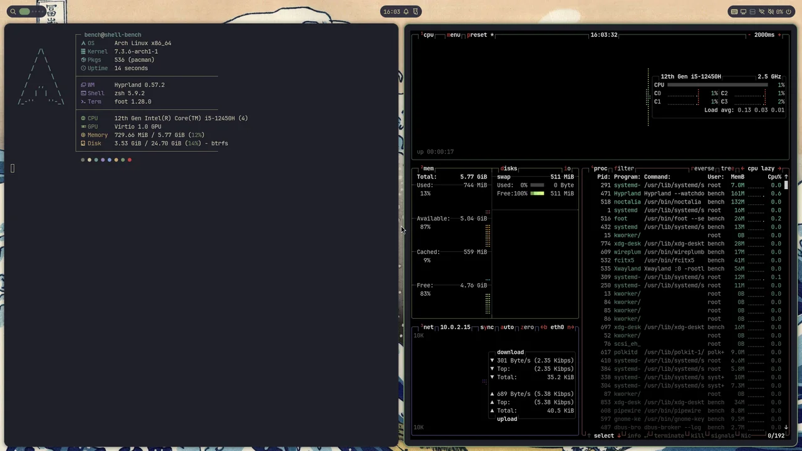

- `main` — current setup powered by **Noctalia Shell v5.x (C++)**
- `legacy-waybar` — previous Waybar / swaybg / Fnott / Fuzzel / Hyprlock setup

## Quick Start

Fresh Arch Linux / CachyOS one-liner (installs `git` if missing, clones cleanly, and launches the interactive TUI installer):

```sh
bash <(curl -fsSL https://raw.githubusercontent.com/minkhoaa/kaze-dots/main/scripts/bootstrap.sh)
```

To install from a pinned release tag instead of `main`, pass `--branch <tag>` (e.g. `--branch v0.1.0`):

```sh
bash <(curl -fsSL https://raw.githubusercontent.com/minkhoaa/kaze-dots/main/scripts/bootstrap.sh) --branch v0.1.0
```

Or pass flags directly through to `install.sh`:

```sh
# Preview exact packages, GPU detection, Snapper availability, and actions without writing anything
./scripts/install.sh --profile full --dry-run

# Default installs: Dynamic Island + Kanagawa (4K wallpaper & theme) + noctalia-greeter + yay-bin
./scripts/install.sh --profile minimal --style dynamic-island
./scripts/install.sh --profile full --style dynamic-island

# Customize Display Manager (--dm noctalia|ly|greetd|none), AUR helper (--aur yay-bin|paru-bin|none), or snapshots (--snapshot|--no-snapshot)
./scripts/install.sh --profile full --dm ly --aur paru-bin
./scripts/install.sh --profile minimal --dm none --aur none --no-snapshot

# Apply dotfiles only (skip pacman, system setup, DM, and AUR helper)
./scripts/install.sh --skip-packages
```

### Rollback & OS Snapshots

```sh
# Restore user dotfiles/symlinks/seeded configs (unprivileged; preserves ~/.config/hypr/user.lua)
"$(cat ~/.config/kaze/last-backup)/rollback.sh"

# Also revert recorded system changes (login shell, newly enabled systemd/DM units, greetd config backup)
"$(cat ~/.config/kaze/last-backup)/rollback.sh" --system
```

- **Scope:** Default `rollback.sh` restores only user configuration files under `$HOME`/`$XDG_CONFIG_HOME` (never touches `hypr/user.lua`). Adding `--system` reverts recorded shell, service, and Display Manager changes while **never** auto-removing packages (newly installed packages are recorded in `packages-added.list`).
- **Full OS Rollback (Btrfs / Snapper):** If `snapper` is configured for `root`, `install.sh` automatically creates a `pre`/`post` snapshot pair around installation (disable with `--no-snapshot`, require with `--snapshot`) and prints the exact `sudo snapper -c root undochange <pre>..<post>` command.

## Visual Styles (11 Presets)

Switch live anytime with `Super + Shift + I` or `kaze-style <preset>` (0 extra daemons, 0 polling). All 11 presets update Noctalia bar/dock geometry, Hyprland borders/corners/gaps, and GTK3/Thunar styling cleanly.

### Dynamic & Modern

| `dynamic-island` *(Default)* | `hardware-notch` |
| :---: | :---: |
|  | 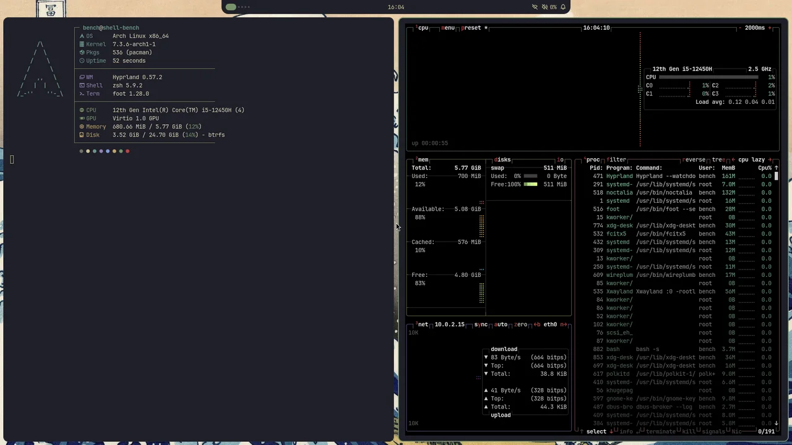 |
| 3-cluster top bar with centered Live Activity island & right quick controls | Flush top center notch with concave corners & focus dots |

| `glass-studio` | `floating-rail` |
| :---: | :---: |
| 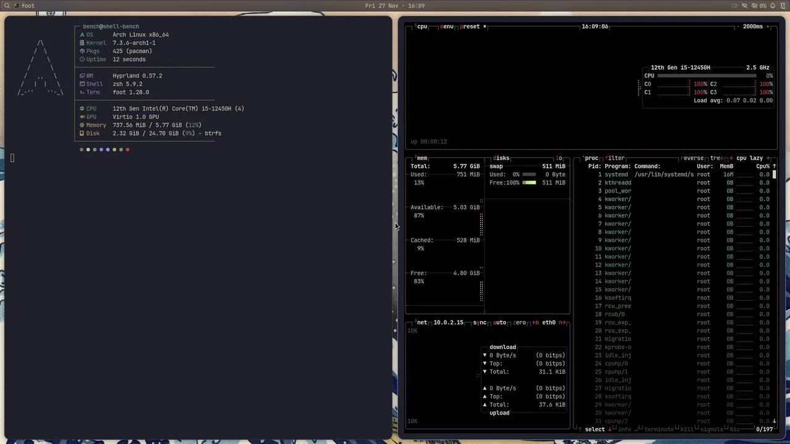 | 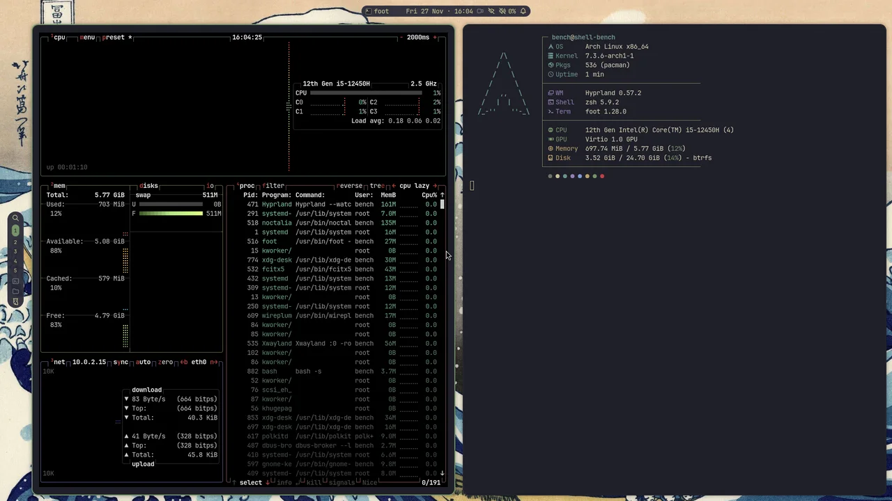 |
| 28px frosted glass top menu bar, auto-hiding dock, 14px corners & shadows | Two-tier floating top status pill + left workspace/launcher rail |

### Angular & Minimal

| `omarchy-rail` | `swiss-grid` |
| :---: | :---: |
| 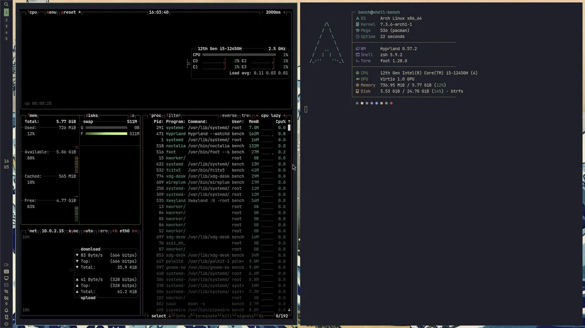 | 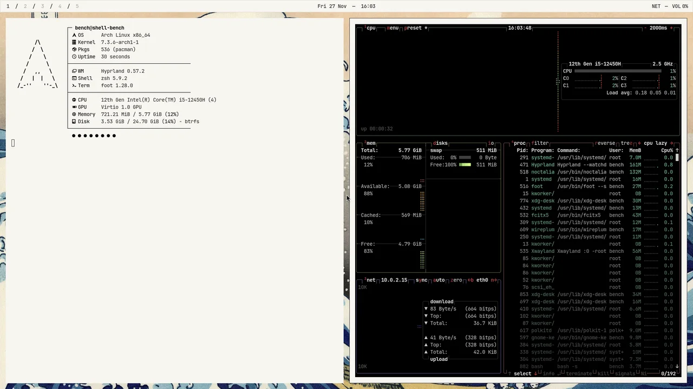 |
| Flush left 42px industrial rail, 0px corners, 2px borders, 0 shadows | `Kaze-Swiss` warm paper light grid, 1px hairline rules, text-only top bar |

| `corner-hud` | `ghost-zero` |
| :---: | :---: |
| 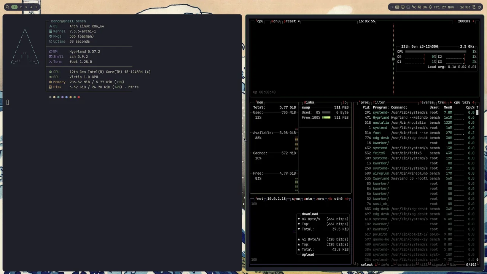 | 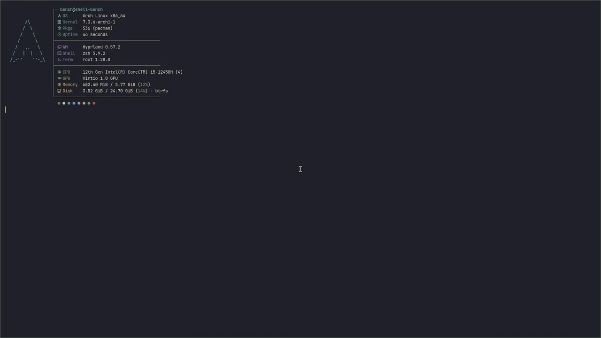 |
| Transparent top bar with two corner islands and open center horizon | Auto-hide bar (`Super` hold-to-peek) + 0px edge-to-edge focus canvas |

### Retro & Editorial

| `tui-hacker` | `retro-90s` | `cinema-frame` |
| :---: | :---: | :---: |
| 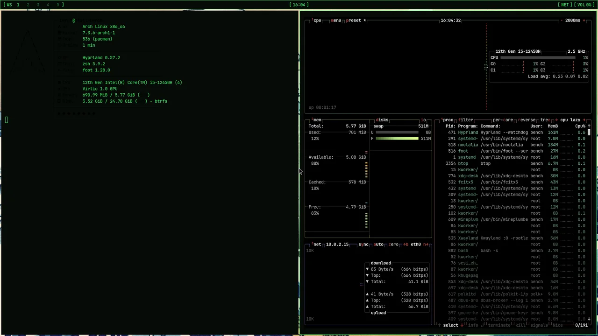 | 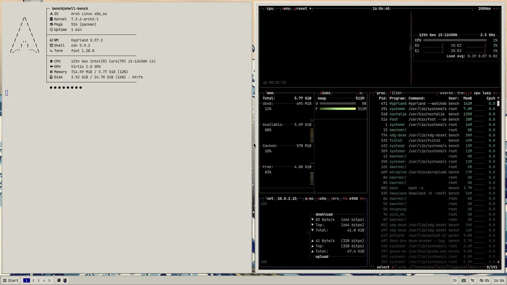 | 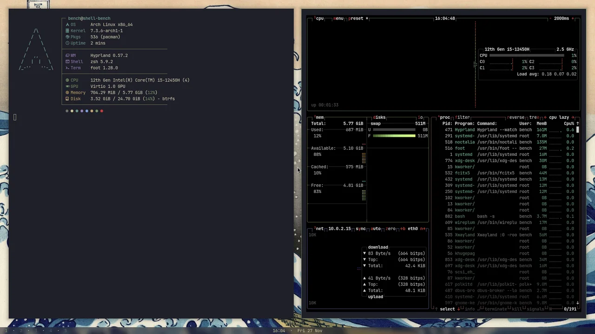 |
| `Kaze-Phosphor` CRT palette & bracketed `[ WS ]` text status | `Kaze-Retro90s` gray palette, 36px bottom Start taskbar & 3D bevels | Wide 28px gallery margins + ultra-slim 22px bottom subtitle strip |

## Benchmarks

Measured in an isolated clean Arch Linux KVM guest (`1920×1080`, VirGL 3D, `Hyprland 0.57.2`, `Noctalia 5.6.0`, `Foot 1.28.0`) using [tests/vm/idle_sampler.py](tests/vm/idle_sampler.py) at **T0** (cold boot → 45s settle → 60s sampling window before any interactive probe). Reproduce locally with `./tests/vm/verify.sh --samples 3` (protocol in [docs/specs/05-verification-and-benchmarks.md](docs/specs/05-verification-and-benchmarks.md)).

| Metric | Budget (`minimal`) | Measured (`minimal`, steady-state)\* | Measured (`full`)\*\* |
| --- | --- | --- | --- |
| **Shell stack PSS** (`noctalia` + `foot --server`) | **≤ 100 MiB** | **90.4 – 90.7 MiB** (`noctalia` 85.8–86.1, `foot` 4.55) | **88.5 MiB** (`noctalia` 84.0, `foot` 4.51) |
| **Shell + Session PSS** | **≤ 105 MiB** | **91.7 – 92.0 MiB** | 154.3 MiB *(includes `fcitx5` + `gnome-keyring`)* |
| **Shell idle CPU** | **≤ 0.20%** | **0.10%** | **0.10%** |
| **Shell context switches** | **≤ 8.0 CS/s** | **5.05 – 5.08 CS/s** | **5.08 CS/s** |
| **Early XDG portals at T0** | **0** | **0** (`none`) | On-demand via keyring/IME |
| **Resident shell daemons** | **2** | **2** (`noctalia`, `foot`) | **3** (`noctalia`, `foot`, `fcitx5`) |
| **Cold boot → Hyprland + bar ready** | — | **10 – 11s** *(KVM VM)* | **11s** *(KVM VM)* |

*\*Across 3 independent cold boots on clean Arch: boot 1 warms Noctalia's initial font/4K-wallpaper cache (`100.25 MiB` PSS); normal cold boots (samples 2–3) settle at `90.37 – 90.65 MiB` PSS. On CachyOS (`7.3.5-cachyos`), `noctalia` + `foot` measured `92.2 MiB` PSS.*  
*\*\*`full` adds `fcitx5-bamboo` and `gnome-keyring`; shell stack itself remains `88.5 MiB` PSS.*

## GPU Compatibility

`install.sh` automatically classifies DRM hardware via `/sys/class/drm` and adapts Hyprland/greeter settings without touching existing `~/.config/hypr/user.lua`:

| Hardware | Status | Installer & Runtime Behavior | Notes / Prerequisites |
| --- | --- | --- | --- |
| **Intel iGPU** | Tested | Works out of the box (Mesa `iris`/`crocus`) | Zero extra configuration required |
| **AMD (iGPU / dGPU)** | Supported | Works out of the box (Mesa `radeonsi`) | Zero extra configuration required |
| **Hybrid Laptop (Intel/AMD + NVIDIA)** | Tested | Auto-seeds `drm_devices` (iGPU) + `prefer_mesa_egl = true` into new `~/.config/hypr/user.lua` | Append `:/dev/dri/cardX` if an external port is wired to dGPU; pin a colon-free udev symlink if card numbers swap across reboots |
| **Desktop Single NVIDIA** | Supported | Prints preflight reminder; leaves `user.lua` clean | Requires `nvidia-open` (or `nvidia`) driver and `nvidia_drm.modeset=1` kernel parameter |
| **VM (QEMU/KVM VirGL)** | Tested (CI/VM) | Auto-adds `WLR_NO_HARDWARE_CURSORS=1` to `noctalia-greeter` | Verified headless & GTK GL at `1920×1080` (single & dual monitor) |

## Highlights

- **Compositor & Session:** Hyprland 0.57+ configured natively in Lua (`hypr/*.lua`), systemd user session (`kaze-session.target`), automatic hybrid-GPU `user.lua` seeding, and on-demand XDG portals.
- **Noctalia Shell & Greeter:** Pure C++ shell (`noctalia`, offline/zero-telemetry) plus **`noctalia-greeter`** (via `greetd`, 0 Qt/GTK/Xorg) pre-seeded with the **Kanagawa** theme & 4K wallpaper. Built-in templates live-theme Hyprland, Foot, GTK3/4, and `btop`.
- **16 Themes & 10 Curated 4K Wallpapers:** 8 Noctalia built-in themes (default **Kanagawa**) + 8 bundled Version-2 custom palettes (`Kaze-Swiss`, `Kaze-Phosphor`, `Kaze-Amber`, `Kaze-Retro90s`, `Kaze-RosePine`, `Kaze-Everforest`, `Kaze-Monochrome`, `Kaze-Sakura`) + 10 MIT-licensed 4K wallpapers in [assets/wallpapers/](assets/wallpapers/) linked into `~/Pictures/Wallpapers/` (`Super + Shift + W`).
- **Terminal & Shell:** Foot (`foot --server` + live-themed `kaze-footclient`), modular Zsh (`~/.zprofile`, `~/.zshrc`, `conf.d/*.zsh`), and pure-ANSI single-line Starship prompt.
- **Vietnamese IME (`full` profile):** `fcitx5` + `fcitx5-bamboo` (Telex) pre-configured with `Ctrl + Shift` and `Ctrl + Space` toggle and shared input state across apps.
- **Safe, Coexistence-Aware Installer:** Syncs via `pacman -Syu --needed`, resolves hard audio conflicts (`pulseaudio` / `pipewire-media-session`) **atomically** inside one `pacman` transaction via `--ask=4` (zero `pacman -Rdd`), refuses to overwrite existing Display Managers (`sddm`, `gdm`, `lightdm`, etc.) or active network stacks (`systemd-networkd`, `iwd`, `dhcpcd`, `netctl`), creates optional Snapper pre/post snapshots, records system changes for `rollback.sh --system`, builds **`yay-bin`** after core dotfiles deploy, logs ANSI-clean output to `~/.local/state/kaze/install-*.log`, and verifies with `kaze-doctor --offline`.

## Profiles

| Profile | Official Packages | Included |
| --- | --- | --- |
| `minimal` | 27 core + add-ons | Hyprland, Noctalia, Foot, Zsh (+ plugins), PipeWire/WirePlumber, NetworkManager, BlueZ, `btop`, JetBrainsMono Nerd Font, Lua, XDG portals |
| `full` | 55 core + add-ons | Everything in `minimal` + Thunar, `papirus-icon-theme`, `xdg-user-dirs`, Yazi (Sixel), Zathura, `imv`, `wf-recorder`/`ffmpeg`/`slurp`, `hyprpicker`, `wl-mirror`, `gnome-keyring`, `fcitx5-bamboo`, Noto fonts (Latin/CJK/Emoji), `fzf`, `zoxide`, `eza`, `bat`, `ripgrep`, `fd`, `starship`, `fastfetch` |

*(Default add-ons: `greetd` + `noctalia-greeter` for login screen and `base-devel` + `git` for `yay-bin`; disable with `--dm none --aur none`.)*

## Repo Layout

```text
hypr/                    Hyprland Lua config (env, core, rules, execs, keybinds)
config/noctalia/         Default Noctalia config (Kanagawa, offline, built-in templates) + 8 custom palettes
assets/wallpapers/       10 curated 4K MIT-licensed wallpapers (linked into ~/Pictures/Wallpapers/)
assets/screenshots/      WebP showcase gallery of all 11 visual styles
config/foot/             Foot terminal config (includes live Noctalia theme)
config/gtk-3.0/          GTK3 settings (adw-gtk3-dark) & Noctalia CSS for Thunar
config/Thunar/           Thunar custom actions (uca.xml) & keyboard shortcuts (accels.scm)
config/xfce4/            Seeded minimal Thunar xfconf defaults (thunar.xml)
config/yazi/             Yazi config (Foot Sixel previews, ANSI theme, Vim keymap)
config/zathura/          Minimal flat Zathura PDF viewer config
config/imv/              Minimal Wayland imv image viewer config
config/mimeapps.list     Default XDG file associations (thunar, imv, zathura)
config/xdg-terminals.list Default XDG terminal priority (footclient, foot)
config/browsers/         Shared Chromium-family download/QUIC flags (Chrome, Chromium, Brave, Edge, Vivaldi)
config/starship/         Single-line ANSI Starship prompt config
config/fastfetch/        Minimal ANSI-colored Fastfetch system info config
config/zsh/              Modular Zsh config (~/.zprofile, ~/.zshrc, conf.d/*.zsh)
config/systemd/user/     Session target and user service units (Noctalia, Foot, Fcitx5, Recorder)
lua/kaze/                Pure-Lua helper modules (hypr_user, styles, display, projects, mirror, session)
bin/                     11 small Lua helper CLIs for things Noctalia doesn't cover
scripts/                 Bootstrap, modular installer (install.sh, install-lib.sh, install-tui.sh, packages.sh), apply/rollback, and VM launcher
templates/               Example ~/.config/hypr/user.lua override file
tests/                   Unit, integration, and isolated VM verification suites
docs/specs/              Architecture, layout presets, theming, CLI/keybinds, and benchmark specs
```

### Helper CLIs (`bin/`)

- `kaze-session` — start/stop `kaze-session.target`, lock screen, wake displays
- `kaze-footclient` — launch `footclient` with live Noctalia theme overrides
- `kaze-style` — switch across 11 Noctalia + Hyprland + GTK3 visual presets
- `kaze-display` — multi-monitor layout picker, HDMI presentation, and Virtual Share 1080p (Meet/Discord)
- `kaze-record` — full/region screen, audio & GIF recording (`wf-recorder` + `ffmpeg`, `noctalia dmenu`)
- `kaze-mirror` — Arch/CachyOS HTTPS mirror ranker & `ParallelDownloads` benchmark (`--tui-window`, `--apply`, `--rollback`)
- `kaze-project` — `zoxide`/`fd` project switcher (Foot shell or Neovim + terminal split)
- `kaze-keys` — searchable Hyprland shortcut list (`noctalia dmenu`)
- `kaze-tui` — toggle floating `btop` window
- `kaze-thunar-action` — Thunar custom actions (`terminal`, `yazi`, `editor`, `copy-path`, `copy-image`, `wallpaper`, tarbomb-safe `extract`, `compress`, `checksum`)
- `kaze-doctor` — health check for binaries, symlinks, configs, portals, services, and config drift (`--diff`)

## Main Keybinds

Press `Super + /` anytime to search all bindings (`kaze-keys`).

| Keybind | Action |
| --- | --- |
| `Super` (tap) / `Super + Space` | App launcher |
| `Super + Return` / `Super + T` | Terminal (`foot`) |
| `Super + O` / `Super + Shift + O` | Project switcher (`zoxide`/`fd`) / Neovim + terminal split |
| `Super + Shift + Z` | Focus / Game Mode (0 animations/blur/gaps + DND) |
| `Super + A` / `Super + N` | Control Center / Notifications |
| `Super + I` / `Super + Shift + I` | Noctalia Settings / Visual style switcher (`kaze-style`) |
| `Super + Shift + T` | Toggle Dark / Light mode |
| `Super + Shift + W` | Wallpaper picker |
| `Super + V` | Clipboard history |
| `Super + /` | Search keybinds |
| `Super + Shift + P` | Display / Present Workspace / Virtual Share (1080p) menu |
| `Ctrl + Super + P` / `Super + Alt + P` | Toggle control on presented workspace / Push-pull window to share |
| `Ctrl + Shift` / `Ctrl + Space` | Toggle Vietnamese IME (`fcitx5-bamboo`, `full` profile) |
| `Ctrl + Shift + Esc` | Floating `btop` |
| `Ctrl + Alt + M` | Mirror Optimizer TUI (`kaze-mirror --tui-window`) |
| `Print` / `Super + Shift + S` / `Super + Shift + Alt + S` | Full / Region / Annotate screenshot |
| `Super + Shift + C` | Color picker (`hyprpicker`) |
| `Ctrl + Alt + R` / `Super + Shift + Alt + R` / `Super + Shift + R` | Full / Region recording / Recording menu (`kaze-record`) |
| `Super + L` / `Ctrl + Alt + Del` | Lock / Session menu |
| `Ctrl + Super + Alt + R` | Reload Noctalia & Hyprland |

## Customization & Maintenance

- **Bar, themes, wallpaper, widgets:** edit directly in Noctalia Settings (`Super + I`) or `~/.config/noctalia/config.toml` — re-running `apply.sh` preserves your edits.
- **Per-machine Hyprland overrides:** edit `~/.config/hypr/user.lua` (see [templates/hypr-user.lua.example](templates/hypr-user.lua.example)) for monitors, default apps, hybrid GPU settings, or disabling `fcitx5`.
- **Per-machine Zsh overrides:** put aliases/env vars in `~/.config/zsh/user.zsh` (login-only tweaks in `~/.config/zsh/zprofile.local`).
- **Diagnostics & Config Drift:** run `kaze-doctor` inside a session or `kaze-doctor --diff` after pulling updates to inspect newly added upstream Noctalia config sections without clobbering your edits.

## License & Credits

- Licensed under the [MIT License](LICENSE).
- Built around [Noctalia Shell](https://github.com/noctalia-dev) and [Hyprland](https://hypr.land/).
- Bundled 4K wallpapers in [assets/wallpapers/](assets/wallpapers/) are curated from [omacom/omarchy](https://github.com/omacom/omarchy) (MIT License).
